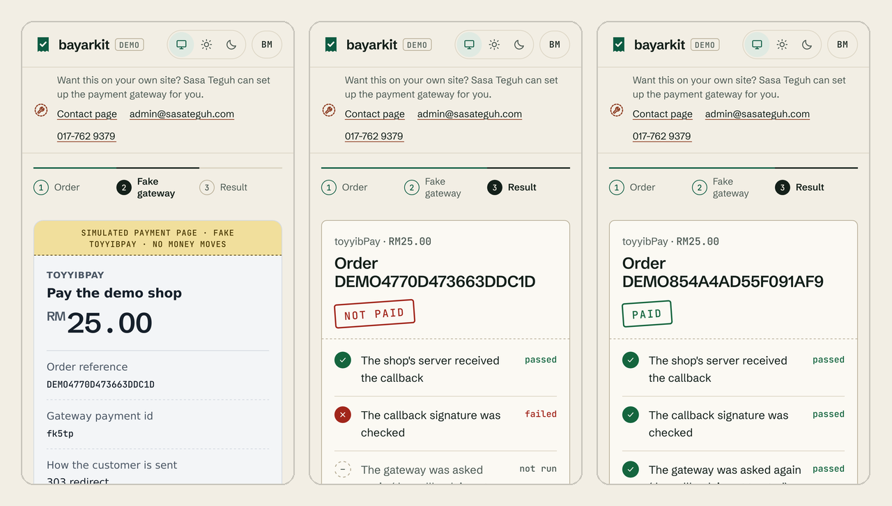

# bayarkit

One interface for Malaysian payment gateways (plus Paddle and PayPal for selling abroad), in TypeScript and PHP/Laravel,
and a checked way to confirm a payment:
the callback signature, a fresh query to the gateway, and an exact match on reference, amount and currency.
Your checkout and callback code stay the same when you switch gateways; only the adapter and its keys change.

[Bahasa Melayu](README.ms.md) · **[Try the demo](https://bayarkit.sasateguh.com/en)** (fake gateways, no money)

> **Status:** 0.2.2. Sixteen gateways in TypeScript; Paddle and PayPal are in this repository but not on npm yet.
> toyyibPay, Billplz, Bayarcash, Stripe and Paddle are measured on their sandboxes; the others are written from
> official sources and have not yet run against a real gateway (the table says which source). PHP/Laravel covers toyyibPay,
> CHIP, Paddle and PayPal.

## Why

- **Switching gateways should not mean rewriting checkout.** Every adapter implements the same `Gateway` interface:
  `createPayment`, `getPayment`, `verifyCallback`.
- **A callback is only a claim.** It can be forged, replayed from an earlier payment, or real but for another order
  or amount. `confirmPayment` does all three checks every time: the callback signature, a fresh query to the gateway
  (a valid signature can be replayed), and an exact match on reference, amount and currency.
- **Sandboxes do not always behave like their docs.** The toyyibPay adapter and its fake follow what the sandbox
  actually returned, not what the reference says (table below). Each adapter states where its behaviour comes from.
- **Test without real money.** `@bayarkit/testing` ships fake gateways and a conformance suite that every adapter must
  pass.

## Gateways

<!-- gateways:table (generated from gateways/registry.json by `node tools/rujukan.mjs skills`) -->
| Gateway                                          | Package               | Evidence                                                                                                                                                                     |
| ------------------------------------------------ | --------------------- | ---------------------------------------------------------------------------------------------------------------------------------------------------------------------------- |
| toyyibPay                                        | `@bayarkit/toyyibpay` | Measured on the sandbox, 10 Oct 2026, including a real test-bank FPX payment; the status query with and without `userSecretKey` re-measured 27 Oct 2026                      |
| Bayarcash (also behind BCL.my)                   | `@bayarkit/bayarcash` | Measured on the sandbox, 27 Oct 2026: a paid and a failed FPX payment through the adapter (return URL, status query, portal); the server-to-server callback was not observed |
| Billplz                                          | `@bayarkit/billplz`   | Measured on the sandbox, 27 Oct 2026: a paid and a failed payment, with the real callback and the redirect verified by the adapter                                           |
| CHIP (CHIP Collect)                              | `@bayarkit/chip`      | Official CHIP Collect OpenAPI; not yet measured in test mode                                                                                                                 |
| Stripe (Malaysia): card + FPX                    | `@bayarkit/stripe`    | Measured in test mode, 27 Oct 2026: a card and an FPX payment through the adapter with a real webhook (API `2026-09-30.endive`), and a failed FPX payment                    |
| senangPay (on the DOKU platform)                 | `@bayarkit/senangpay` | Official DOKU Malaysia API Reference (Checkout, `HMACSHA256=` Signature) and the senangPay DOKU FAQ; not yet measured on the sandbox                                         |
| iPay88 (NTT DATA Payment Services Malaysia)      | `@bayarkit/ipay88`    | Official signature tools and HMAC script on the gateway host (three vectors), enquiry.asp probed live; no public API docs; not yet measured                                  |
| Fiuu (formerly Razer Merchant Services / MOLPay) | `@bayarkit/fiuu`      | Official API spec PDF v13.97 (the official vcode test vector), WooCommerce plugin and PHP SDK; not yet measured on the sandbox                                               |
| 2C2P (PGW Payment API v4.x)                      | `@bayarkit/2c2p`      | Official developer docs (Payment Token + HS256 JWT, three official JWT test vectors); not yet measured on the sandbox                                                        |
| Razorpay Curlec                                  | `@bayarkit/curlec`    | Official docs (Payment Links + Orders, three signatures, all five official test vectors); not yet measured in test mode                                                      |
| HitPay                                           | `@bayarkit/hitpay`    | Official docs (OpenAPI, Payment Requests, both webhook signatures) and official PHP SDK; not yet measured on the sandbox                                                     |
| Gkash                                            | `@bayarkit/gkash`     | Official docs (SHA-512 signature test vectors), WooCommerce plugin and gkashmy SDKs; not yet measured on staging                                                             |
| Xendit (Malaysia): Payment Sessions              | `@bayarkit/xendit`    | Official docs (Payment Sessions, v3 payment requests, `x-callback-token` webhooks: a static token, not a signature) and Xendit's agent skill; not yet measured in test mode  |
| eGHL (ADAPTIS e-Commerce)                        | `@bayarkit/eghl`      | Official eGHL public code (hash class, merchant-api QUERY, Omnipay HashValue2 test vector; no public API guide exists); not yet measured on the test host                    |
| Paddle Billing (merchant of record, no MYR)      | `@bayarkit/paddle`    | Measured on the sandbox, 30 Oct 2026: card paid and declined, real signed webhooks, full and partial refunds; charges in USD or another Paddle currency, never MYR           |
| PayPal Orders v2 (approve, then capture)         | `@bayarkit/paypal`    | Official PayPal REST docs and OpenAPI files; paid only when the capture is COMPLETED, webhooks verified by PayPal's postback; not yet measured on the sandbox                |
<!-- /gateways:table -->

Researched but without an adapter yet: Adyen and Airwallex (specs in [gateways/README.md](gateways/README.md)). An adapter is
listed as _measured_ only after the conformance suite has run against that gateway's sandbox.

Amounts are always integer **sen** (`1050` = RM10.50), so nothing compares floating-point ringgit. Paddle and PayPal
charge in other currencies (USD by default): there an amount is an integer in that currency's smallest unit (`1050` =
USD 10.50), and every check names the `currency`.

## Install

```bash
npm install @bayarkit/core @bayarkit/toyyibpay   # core, plus one package for each gateway you use
```

Node.js 22.12 or later (CI runs 22 and 24). The adapters use `node:crypto`, so runtimes without it (Cloudflare
Workers, Vercel Edge) are not supported. PHP/Laravel: `composer require bayarkit/bayarkit`, see
[PHP and Laravel](#php-and-laravel).

## Quick start

Two routes: one starts the payment, the other receives the gateway's callback.

```ts
import { checkoutResponse, confirmPayment, readCallback } from '@bayarkit/core'
import { toyyibpay } from '@bayarkit/toyyibpay'

const gateway = toyyibpay({ secretKey, categoryCode, environment: 'sandbox' })

// POST /checkout: one reference per attempt, then send the customer to the gateway.
const payment = await gateway.createPayment({
  reference: 'ORD1001',
  amount: 1050, // sen: RM10.50
  description: 'Order 1001',
  customer: { name: 'Ali', email: 'ali@example.com' },
  returnUrl: 'https://shop.example/thank-you',
  callbackUrl: 'https://shop.example/api/payment/callback',
})
// Save payment.id with the order. Then answer with a 303 redirect, or a self-submitting POST page for gateways
// that want a form (iPay88, eGHL, Fiuu).
return checkoutResponse(payment, 'Continue to payment')

// POST /api/payment/callback: never mark an order paid from the callback body or the return URL alone.
const callback = await readCallback(request) // JSON, url-encoded or multipart (toyyibPay posts multipart)
const verified = gateway.verifyCallback(callback) // null when the signature is wrong
// Your lookup: by verified.reference, or by the saved payment.id when the gateway sends no reference (Billplz).
const order = await findOrder(verified)
const result = await confirmPayment(gateway, callback, { reference: order.reference, amount: order.amount })
if (result.ok) {
  // mark the order paid (idempotently: gateways retry callbacks)
}
```

Both routes, complete, as Web-standard `Request` → `Response` handlers (Next.js route handlers, Hono and the like) are
in [examples/web-standard/checkout.ts](examples/web-standard/checkout.ts). Its test runs the same two handlers,
unchanged, against the fake of every gateway. To use Bayarcash instead, replace the `toyyibpay(...)` call with
`bayarcash({ token, secretKey, portalKey, environment: 'sandbox' })`.

For CHIP, use `chip({ secretKey, brandId, publicKey, environment: 'test' })`. CHIP has one host: a test-mode secret key makes test
purchases. Callbacks are signed with CHIP's RSA key over the raw body, so read them with `readCallback` (not a parsed
body). Get the public key once with `await chip({ secretKey, brandId, environment: 'test' }).fetchPublicKey()` (same secret key), store it,
and pass it as `publicKey`; without it every callback is refused. CHIP rejects a `callbackUrl` with a port, even `:443`.
`environment` is required (`'test'` with a test key, `'live'` with a live key): a purchase from the other mode, or one
that does not say which it is, is refused, so a test payment does not confirm a live order.

### Paddle and PayPal (selling abroad)

Neither charges ringgit by default, so set `currency` on the adapter and pass the same `currency` to
`createPayment` and `confirmPayment`. Both send their notifications to one webhook URL set in their dashboards, not to
a `callbackUrl` per payment.

**Paddle** (merchant of record: Paddle sells to the buyer and handles tax). Paddle has no MYR.

```ts
const gateway = paddle({ apiKey, webhookSecret, currency: 'USD' })
const payment = await gateway.createPayment({
  reference,
  amount,
  currency: 'USD',
  description,
  customer,
  returnUrl,
  callbackUrl,
})
// payment.url = your default payment link + ?_ptxn=<id>; or open an overlay: Paddle.Checkout.open({ transactionId: payment.id })
const result = await confirmPayment(gateway, await readCallback(request), {
  reference,
  amount,
  currency: 'USD',
})
```

- Set a default payment link in Paddle > Checkout first (a page of yours that loads Paddle.js); until then Paddle
  refuses every new transaction. `returnUrl` and `callbackUrl` are not sent: add a notification destination for
  `transaction.*` events that points at your callback route.
- The price is sent tax-inclusive with its quantity fixed at 1, so the buyer pays exactly `amount` and
  `confirmPayment` compares that total.
- Refunds (`gateway.refundPayment`) wait for Paddle's approval: the result is `pending` first.

**PayPal** (Orders v2). Paying takes two steps, and approving is not paying.

```ts
const gateway = paypal({ clientId, clientSecret, webhookId, currency: 'USD' })
const payment = await gateway.createPayment({
  reference,
  amount,
  currency: 'USD',
  description,
  customer,
  returnUrl,
  callbackUrl,
})
// Save payment.id with the order and send the buyer to payment.url (PayPal's approval page).

// GET /thank-you (returnUrl): the buyer approved; nothing has moved yet. Capture with the saved id.
await gateway.capturePayment(order.paymentId) // safe to retry: PayPal returns the first capture again

// POST /api/payment/callback (your PayPal webhook): mark paid on PAYMENT.CAPTURE.COMPLETED.
const result = await confirmPayment(gateway, await readCallback(request), {
  reference,
  amount,
  currency: 'USD',
})
```

- `getPayment` only reads; an approved but uncaptured order is `pending`. Paid means the capture is `COMPLETED`.
- `webhookId` is the id of the webhook you add to your PayPal REST app. `verifyCallback` asks PayPal to verify each
  event (`verify-webhook-signature`), so it is async; if PayPal cannot be reached, `confirmPayment` answers
  `gateway_error` (retry), not `invalid_signature`.
- MYR works only for a Malaysian PayPal account.

Both adapters can refund: `await gateway.refundPayment({ paymentId, amount })` with an amount up to what is left
(checked before calling the gateway). It returns `pending`, `succeeded`, `failed` or `unknown`. Other adapters do not
implement refunds yet.

## What `confirmPayment` checks

| Step                              | Rejects                                                        | Result              |
| --------------------------------- | -------------------------------------------------------------- | ------------------- |
| Callback signature                | forged or altered callbacks                                    | `invalid_signature` |
| Fresh query to the gateway        | replayed callbacks, callbacks sent before payment, leaked keys | `not_paid`          |
| Reference, amount (sen), currency | a real payment for another order or another amount             | `mismatch`          |
| Gateway unreachable               | nothing: retry later                                           | `gateway_error`     |

## toyyibPay: docs vs the sandbox

Measured on `dev.toyyibpay.com`, 10 October 2026:

| Thing                     | Docs               | Sandbox                                                                                                   |
| ------------------------- | ------------------ | --------------------------------------------------------------------------------------------------------- |
| Response body             | JSON               | prefixed with tabs, sent as `text/html`                                                                   |
| Bill with no transactions | `[]`               | the text `No data found!`                                                                                 |
| `getCategoryDetails`      | `[{categoryName}]` | `{CategoryName}`                                                                                          |
| createBill errors         | not documented     | `[KEY-DID-NOT-EXIST-OR-USER-IS-NOT-ACTIVE]`, `[CATEGORY-NOT-MATCH]`, or JSON `{"status":"error","msg":…}` |
| `billExpiryDate`          | format only        | read in Malaysia time                                                                                     |
| Minimum amount            | "more than RM1.00" | RM1.00 itself is accepted                                                                                 |
| Callback body             | form post          | `multipart/form-data`                                                                                     |

## Watching the gateways' docs

Adapters are half of it. The other half is knowing what each gateway's official documentation says today:
- [`gateways/registry.json`](gateways/registry.json) lists every Malaysian gateway bayarkit knows about, with its
  official documentation and official SDK code as sources.
- Each researched gateway has a spec (`gateways/<id>/spec.md`) with an official source next to every fact, and a list
  of traps: places where the docs, the official SDK or the official AI skill are wrong or out of date.
- `node tools/rujukan.mjs check` fingerprints every source and reports when one changes; the maintainer's server runs it
  daily, and each change is read by hand before the spec, the fake or the adapter moves. A source must contain words it declares (`mustContain`), so a docs page
  that turns into a JavaScript shell or a login wall fails loudly instead of being "watched".
- `skills/<id>/SKILL.md` are generated from the same data for AI coding agents, and point at runnable, tested code.

Coverage, generated: [gateways/README.md](gateways/README.md). Only fingerprints are stored here; the documentation
itself belongs to each gateway.

## Testing your own code

```ts
import { confirmPayment } from '@bayarkit/core'
import { startFakeToyyibPay } from '@bayarkit/testing'
import { toyyibpay } from '@bayarkit/toyyibpay'

const fake = await startFakeToyyibPay({ secretKey: 's', categoryCode: 'c' })
const gateway = toyyibpay({ secretKey: 's', categoryCode: 'c', environment: 'sandbox', baseUrl: fake.url })
const order = { reference: 'T1', amount: 1500 }
const payment = await gateway.createPayment({
  ...order,
  description: 'Test order',
  customer: { name: 'Ali', email: 'ali@example.com' },
  returnUrl: 'https://shop.example/thank-you',
  callbackUrl: 'https://shop.example/api/payment/callback',
})
// Callbacks are signed exactly like the real gateway's; fake.tamper(...) forges one.
const early = await confirmPayment(gateway, fake.callbackFor(payment.id), order) // not_paid
fake.markPaid(payment.id)
const forged = await confirmPayment(gateway, fake.tamper(fake.callbackFor(payment.id)), order) // invalid_signature
const paid = await confirmPayment(gateway, fake.callbackFor(payment.id), order) // ok
await fake.close()
```

This snippet runs as written in the test suite ([examples/web-standard/test/readme.test.ts](examples/web-standard/test/readme.test.ts)).

### Tests in other languages (PHP/Laravel, Python, Go)

`npx bayarkit-fake <gateway>` runs one fake gateway as a server and prints one JSON line
with its `url` and a `control` URL. Point your app at `url`, then drive it over HTTP: `POST <control>/paid/<id>` marks a
payment paid, `GET <control>/callback/<id>` returns the exact signed callback (`/tampered` for a forged one) to post to
your callback route. For PayPal, `POST <control>/approve/<id>` is the buyer approving without a capture, so you can test
your capture step. It does not need vitest.

## Demo

Hosted at **https://bayarkit.sasateguh.com** (English at `/en`), or run it yourself: `npm run build && npm run demo`
opens http://127.0.0.1:4317/. Pick any gateway, then choose what happens on a simulated payment page (pay; a correctly
signed callback for an unpaid payment; a forged callback; or the paid callback of another, cheaper order) and see each
check `confirmPayment` makes. Every gateway is a fake from `@bayarkit/testing`, so no keys and
no money are involved. Source: [examples/demo](examples/demo/app.mjs).



<sub>Regenerated from the running demo by `python3 scripts/demo-shot.py` (WebKit, iPhone 13).</sub>

## PHP and Laravel

[`php/`](php/README.md) is the PHP twin for Laravel projects: the same interface and the same `confirmPayment` rule
(`Bayarkit\Confirm::payment`), a service provider configured from `.env`, `Callback::from($request)` and
`Checkout::response($payment)`. Install with `composer require bayarkit/bayarkit`. It covers toyyibPay, CHIP, Paddle and PayPal, and every PHP adapter is tested against the same fake
gateways as its TypeScript twin (`scripts/php-gate.sh`, part of the gate).

## Adding a gateway

Write an adapter and a fake, then make them pass `gatewayConformance` from `@bayarkit/testing`.
See [CONTRIBUTING.md](CONTRIBUTING.md).

## How this was built

bayarkit was built with AI coding assistance (Claude Code) under the direction of its author, Muhammad Aiman.

The evidence that it works is meant to be checkable:
- toyyibPay comes from the author's ERP checkout, tested end to end against the toyyibPay sandbox (10 October 2026).
  The other adapters are written from each gateway's official sources, listed with a source next to every fact in
  `gateways/<id>/spec.md`; `info.evidence` says which kind each adapter is.
- The official sources are fingerprinted and checked every day on the maintainer's server (`node tools/rujukan.mjs check`). On the first full day
  it flagged six changed pages: five only flipped absolute and relative links (now ignored), one was a real change to
  toyyibPay's transaction API, which the fake and both adapters now follow.
- `npm run gate` runs offline against the fakes, installs the packed packages into an empty project, and runs the PHP
  twin against the same fakes. Tests that guard money were each checked by breaking the code on purpose (the test must
  fail) before they were trusted.
- Independent AI review agents (fresh sessions with no context of the work) audited the new code and every adapter's path to "paid" (four
  rounds, 23 October 2026). None found a way to mark an unpaid, partial, refunded or authorised-only payment as paid;
  the side paths they did find are listed under "Fixed" in [CHANGELOG.md](CHANGELOG.md), each with a test that failed
  first. The TypeScript and PHP twins agree on 20,030 randomised inputs on PHP 8.2, 8.3 and 8.4.

## License

MIT. See [LICENSE](LICENSE). Security issues: see [SECURITY.md](SECURITY.md).

## Work with Sasa Teguh

[](https://sasateguh.com/book)

This project is built and maintained by [Sasa Teguh](https://sasateguh.com), a studio in Malaysia. We build websites that are found on Google and in AI answers, and we set up systems like this one for businesses.

[Book a call](https://sasateguh.com/book) · hello@sasateguh.com · [More from Sasa Teguh](https://github.com/sasateguh)
