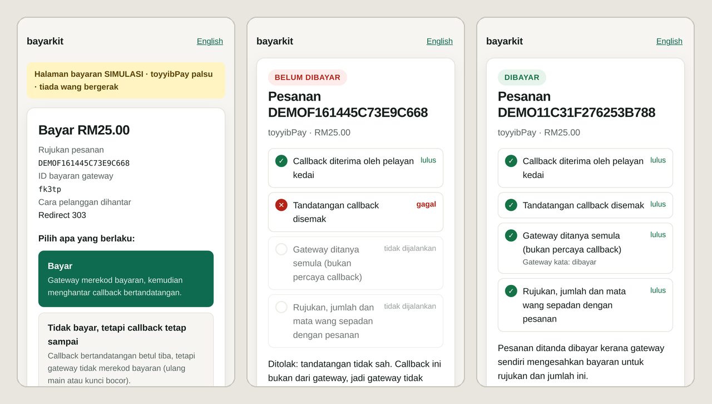

# bayarkit

Satu antara muka untuk gateway pembayaran Malaysia, dalam TypeScript dan PHP/Laravel, dan cara bersemak untuk mengesahkan
bayaran: tandatangan callback, pertanyaan baharu kepada gateway, dan padanan tepat rujukan, amaun dan mata wang.
Kod checkout dan callback anda kekal sama bila anda menukar gateway; hanya adapter dan kuncinya yang berubah.

[English](README.md)

> **Status:** 0.2.0. Empat belas gateway dalam TypeScript: toyyibPay, Billplz, Bayarcash dan Stripe diukur pada sandbox
> masing-masing; yang lain ditulis daripada sumber rasmi dan belum dijalankan terhadap gateway sebenar (jadual
> menyatakan sumbernya). PHP/Laravel meliputi toyyibPay dan CHIP.

## Kenapa

- **Tukar gateway tidak sepatutnya bermakna tulis semula checkout.** Setiap adapter melaksanakan antara muka `Gateway`
  yang sama: `createPayment`, `getPayment`, `verifyCallback`.
- **Callback hanyalah dakwaan.** Ia boleh dipalsukan, dihantar semula daripada bayaran terdahulu, atau benar tetapi
  untuk pesanan atau amaun lain. `confirmPayment` membuat tiga semakan setiap kali:
  tandatangan callback, pertanyaan baharu kepada gateway (tandatangan yang sah boleh dihantar semula), dan padanan
  tepat rujukan, amaun dan mata wang.
- **Sandbox tidak semestinya berkelakuan seperti dokumennya.** Adapter toyyibPay dan gateway palsunya mengikut apa yang
  sandbox benar-benar pulangkan, bukan apa yang dokumen katakan (jadual di bawah). Setiap adapter menyatakan dari mana
  kelakuannya datang.
- **Uji tanpa wang sebenar.** `@bayarkit/testing` membawa gateway palsu dan satu set ujian piawai yang mesti dilulusi
  setiap adapter.

## Gateway

<!-- gateways:table (generated from gateways/registry.json by `node tools/rujukan.mjs skills`) -->
| Gateway                                        | Pakej                 | Bukti                                                                                                                                                                             |
| ---------------------------------------------- | --------------------- | --------------------------------------------------------------------------------------------------------------------------------------------------------------------------------- |
| toyyibPay                                      | `@bayarkit/toyyibpay` | Diukur pada sandbox, 10 Okt 2026, termasuk satu bayaran FPX sebenar dengan bank ujian; pertanyaan status dengan dan tanpa `userSecretKey` diukur semula 27 Okt 2026               |
| Bayarcash (juga di belakang BCL.my)            | `@bayarkit/bayarcash` | Diukur pada sandbox, 27 Okt 2026: satu bayaran FPX berjaya dan satu gagal melalui adapter (URL return, pertanyaan status, portal); callback pelayan-ke-pelayan tidak diperhatikan |
| Billplz                                        | `@bayarkit/billplz`   | Diukur pada sandbox, 27 Okt 2026: satu bayaran berjaya dan satu gagal, dengan callback sebenar dan ubah hala disahkan oleh adapter                                                |
| CHIP (CHIP Collect)                            | `@bayarkit/chip`      | OpenAPI rasmi CHIP Collect; belum diukur dalam mod ujian                                                                                                                          |
| Stripe (Malaysia): kad + FPX                   | `@bayarkit/stripe`    | Diukur dalam mod ujian, 27 Okt 2026: satu bayaran kad dan satu FPX melalui adapter dengan webhook sebenar (API `2026-09-30.endive`), dan satu bayaran FPX yang gagal              |
| senangPay (di platform DOKU)                   | `@bayarkit/senangpay` | Rujukan API rasmi DOKU Malaysia (Checkout, Signature `HMACSHA256=`) dan Soalan Lazim DOKU senangPay; belum diukur pada sandbox                                                    |
| iPay88 (NTT DATA Payment Services Malaysia)    | `@bayarkit/ipay88`    | Alat tandatangan dan skrip HMAC rasmi pada hos gateway (tiga vektor), enquiry.asp diuji secara langsung; tiada dokumen API awam; belum diukur                                     |
| Fiuu (dahulu Razer Merchant Services / MOLPay) | `@bayarkit/fiuu`      | PDF spesifikasi API rasmi v13.97 (vektor ujian vcode rasmi), plugin WooCommerce dan SDK PHP; belum diukur pada sandbox                                                            |
| 2C2P (PGW Payment API v4.x)                    | `@bayarkit/2c2p`      | Dokumen pembangun rasmi (Payment Token + JWT HS256, tiga vektor ujian JWT rasmi); belum diukur pada sandbox                                                                       |
| Razorpay Curlec                                | `@bayarkit/curlec`    | Dokumen rasmi (Payment Links + Orders, tiga tandatangan, kelima-lima vektor ujian rasmi); belum diukur dalam mod ujian                                                            |
| HitPay                                         | `@bayarkit/hitpay`    | Dokumen rasmi (OpenAPI, Payment Requests, kedua-dua tandatangan webhook) dan SDK PHP rasmi; belum diukur pada sandbox                                                             |
| Gkash                                          | `@bayarkit/gkash`     | Dokumen rasmi (vektor ujian tandatangan SHA-512), plugin WooCommerce dan SDK gkashmy; belum diukur pada staging                                                                   |
| Xendit (Malaysia): Payment Sessions            | `@bayarkit/xendit`    | Dokumen rasmi (Payment Sessions, payment request v3, webhook `x-callback-token`: token statik, bukan tandatangan) dan skil agen Xendit; belum diukur dalam mod ujian              |
| eGHL (ADAPTIS e-Commerce)                      | `@bayarkit/eghl`      | Kod awam rasmi eGHL (kelas hash, QUERY merchant-api, vektor ujian HashValue2 Omnipay; tiada panduan API awam); belum diukur pada hos ujian                                        |
<!-- /gateways:table -->

Sudah dikaji tetapi belum ada adapter: Adyen dan Airwallex (spesifikasi dalam [gateways/README.md](gateways/README.md)). Satu
adapter disenaraikan sebagai _diukur_ hanya selepas set ujian piawai dijalankan terhadap sandbox gateway itu.

Amaun sentiasa dalam **sen** integer (`1050` = RM10.50), jadi tiada ringgit titik terapung dibandingkan.

## Pasang

```bash
npm install @bayarkit/core @bayarkit/toyyibpay   # teras, dan satu pakej untuk setiap gateway yang anda guna
```

Node.js 22.12 atau lebih baharu (CI menjalankan 22 dan 24). Adapter menggunakan `node:crypto`, jadi persekitaran tanpanya
(Cloudflare Workers, Vercel Edge) tidak disokong. PHP/Laravel: `composer require bayarkit/bayarkit`, lihat
[PHP dan Laravel](#php-dan-laravel).

## Mula pantas

Dua laluan: satu memulakan bayaran, satu lagi menerima callback daripada gateway.

```ts
import { checkoutResponse, confirmPayment, readCallback } from '@bayarkit/core'
import { toyyibpay } from '@bayarkit/toyyibpay'

const gateway = toyyibpay({ secretKey, categoryCode, environment: 'sandbox' })

// POST /checkout: satu rujukan setiap percubaan, kemudian hantar pelanggan ke gateway.
const payment = await gateway.createPayment({
  reference: 'ORD1001',
  amount: 1050, // sen: RM10.50
  description: 'Order 1001',
  customer: { name: 'Ali', email: 'ali@example.com' },
  returnUrl: 'https://shop.example/thank-you',
  callbackUrl: 'https://shop.example/api/payment/callback',
})
// Simpan payment.id bersama pesanan. Kemudian jawab dengan redirect 303, atau halaman yang menghantar borang POST
// sendiri untuk gateway yang mahukan borang (iPay88, eGHL, Fiuu).
return checkoutResponse(payment, 'Teruskan ke pembayaran')

// POST /api/payment/callback: jangan sesekali tanda pesanan dibayar daripada badan callback atau pautan kembali semata-mata.
const callback = await readCallback(request) // JSON, url-encoded atau multipart (toyyibPay menghantar multipart)
const verified = gateway.verifyCallback(callback) // null bila tandatangan salah
// Carian anda: ikut verified.reference, atau ikut payment.id yang disimpan bila gateway tidak menghantar rujukan (Billplz).
const order = await findOrder(verified)
const result = await confirmPayment(gateway, callback, { reference: order.reference, amount: order.amount })
if (result.ok) {
  // tanda pesanan dibayar (secara idempoten: gateway menghantar semula callback)
}
```

Kedua-dua laluan, lengkap, sebagai pengendali piawai web `Request` → `Response` (pengendali laluan Next.js, Hono dan
seumpamanya) ada dalam [examples/web-standard/checkout.ts](examples/web-standard/checkout.ts). Ujiannya menjalankan dua
pengendali yang sama, tanpa diubah, terhadap gateway palsu setiap gateway. Untuk guna Bayarcash, gantikan panggilan
`toyyibpay(...)` dengan `bayarcash({ token, secretKey, portalKey, environment: 'sandbox' })`.

Untuk CHIP, guna `chip({ secretKey, brandId, publicKey, environment: 'test' })`. CHIP ada satu hos sahaja: kunci rahsia mod ujian membuat
pembelian ujian. Callback ditandatangani dengan kunci RSA CHIP atas badan mentah, jadi bacalah dengan `readCallback`
(bukan badan yang sudah dihurai). Dapatkan kunci awam sekali dengan
`await chip({ secretKey, brandId, environment: 'test' }).fetchPublicKey()` (kunci rahsia yang sama), simpan, dan hantar sebagai `publicKey`;
tanpanya setiap callback ditolak. CHIP menolak `callbackUrl` yang ada port, walaupun `:443`.
`environment` wajib (`'test'` dengan kunci ujian, `'live'` dengan kunci hidup): pembelian daripada mod yang satu lagi,
atau yang tidak menyatakan modnya, ditolak, jadi bayaran ujian tidak mengesahkan pesanan sebenar.

## Apa yang `confirmPayment` semak

| Langkah                          | Menolak                                                                   | Keputusan           |
| -------------------------------- | ------------------------------------------------------------------------- | ------------------- |
| Tandatangan callback             | callback palsu atau diubah                                                | `invalid_signature` |
| Pertanyaan baharu kepada gateway | callback yang dihantar semula, callback sebelum bayaran, kunci yang bocor | `not_paid`          |
| Rujukan, amaun (sen), mata wang  | bayaran sebenar untuk pesanan lain atau amaun lain                        | `mismatch`          |
| Gateway tidak dapat dihubungi    | — (cuba semula kemudian)                                                  | `gateway_error`     |

## toyyibPay: dokumen lawan sandbox

Diukur pada `dev.toyyibpay.com`, 10 Oktober 2026:

| Perkara              | Dokumen                 | Sandbox                                                                                                     |
| -------------------- | ----------------------- | ----------------------------------------------------------------------------------------------------------- |
| Badan jawapan        | JSON                    | didahului tab, dihantar sebagai `text/html`                                                                 |
| Bil tanpa transaksi  | `[]`                    | teks `No data found!`                                                                                       |
| `getCategoryDetails` | `[{categoryName}]`      | `{CategoryName}`                                                                                            |
| Ralat createBill     | tidak didokumenkan      | `[KEY-DID-NOT-EXIST-OR-USER-IS-NOT-ACTIVE]`, `[CATEGORY-NOT-MATCH]`, atau JSON `{"status":"error","msg":…}` |
| `billExpiryDate`     | format sahaja           | dibaca dalam waktu Malaysia                                                                                 |
| Amaun minimum        | "lebih daripada RM1.00" | RM1.00 sendiri diterima                                                                                     |
| Badan callback       | borang                  | `multipart/form-data`                                                                                       |

## Memantau dokumen gateway

Adapter hanyalah separuh. Separuh lagi ialah mengetahui apa yang dokumen rasmi setiap gateway katakan hari ini:
- [`gateways/registry.json`](gateways/registry.json) menyenaraikan setiap gateway Malaysia yang bayarkit kenal, dengan
  dokumen rasmi dan kod SDK rasminya sebagai sumber.
- Setiap gateway yang sudah dikaji mempunyai spesifikasi (`gateways/<id>/spec.md`) dengan sumber rasmi di sebelah
  setiap fakta, dan senarai perangkap: tempat dokumen, SDK rasmi atau skil AI rasmi salah atau sudah lapuk.
- `node tools/rujukan.mjs check` mengambil cap jari setiap sumber dan melaporkan bila ia berubah; pelayan penyelenggara
  menjalankannya setiap hari, dan setiap perubahan dibaca dengan tangan sebelum spesifikasi, gateway palsu atau adapter
  diubah. Setiap sumber mesti mengandungi
  perkataan yang diisytiharkannya (`mustContain`), jadi halaman dokumen yang bertukar menjadi kerangka JavaScript atau
  halaman log masuk gagal dengan jelas, bukan senyap-senyap "dipantau".
- `skills/<id>/SKILL.md` dijana daripada data yang sama untuk ejen pengekodan AI, dan menunjuk ke kod yang boleh
  dijalankan dan sudah diuji.

Liputan, dijana: [gateways/README.md](gateways/README.md). Repo ini hanya menyimpan cap jari; dokumen itu sendiri milik
setiap gateway.

## Menguji kod anda sendiri

```ts
import { confirmPayment } from '@bayarkit/core'
import { startFakeToyyibPay } from '@bayarkit/testing'
import { toyyibpay } from '@bayarkit/toyyibpay'

const fake = await startFakeToyyibPay({ secretKey: 's', categoryCode: 'c' })
const gateway = toyyibpay({ secretKey: 's', categoryCode: 'c', environment: 'sandbox', baseUrl: fake.url })
const order = { reference: 'T1', amount: 1500 }
const payment = await gateway.createPayment({
  ...order,
  description: 'Test order',
  customer: { name: 'Ali', email: 'ali@example.com' },
  returnUrl: 'https://shop.example/thank-you',
  callbackUrl: 'https://shop.example/api/payment/callback',
})
// Callback ditandatangani tepat seperti gateway sebenar; fake.tamper(...) memalsukannya.
const early = await confirmPayment(gateway, fake.callbackFor(payment.id), order) // not_paid
fake.markPaid(payment.id)
const forged = await confirmPayment(gateway, fake.tamper(fake.callbackFor(payment.id)), order) // invalid_signature
const paid = await confirmPayment(gateway, fake.callbackFor(payment.id), order) // ok
await fake.close()
```

Petikan ini dijalankan seperti tertulis dalam set ujian ([examples/web-standard/test/readme.test.ts](examples/web-standard/test/readme.test.ts)).

### Ujian dalam bahasa lain (PHP/Laravel, Python, Go)

`npx bayarkit-fake <gateway>` menjalankan satu gateway palsu sebagai pelayan dan mencetak
satu baris JSON dengan `url`nya dan URL `control`. Halakan aplikasi anda ke `url`, kemudian kawal melalui HTTP:
`POST <control>/paid/<id>` menanda bayaran dibayar, `GET <control>/callback/<id>` memulangkan callback bertandatangan
yang tepat (`/tampered` untuk callback palsu) untuk dihantar ke laluan callback anda. Ia tidak memerlukan vitest.

## Demo

`npm run build && npm run demo` membuka http://127.0.0.1:4317/ (BM di `/`, Inggeris di `/en`): pilih mana-mana
gateway, kemudian pilih apa yang berlaku pada halaman bayaran simulasi (bayar, callback bertandatangan betul untuk
bayaran yang belum dibayar, atau callback yang dipalsukan) dan lihat setiap semakan yang dibuat `confirmPayment`.
Setiap gateway ialah gateway palsu daripada `@bayarkit/testing`, jadi tiada kunci dan tiada wang terlibat. Sumber:
[examples/demo](examples/demo/app.mjs).



<sub>Dijana semula daripada demo yang berjalan oleh `python3 scripts/demo-shot.py` (WebKit, iPhone 13).</sub>

## PHP dan Laravel

[`php/`](php/README.ms.md) ialah kembar PHP untuk projek Laravel: antara muka yang sama dan peraturan `confirmPayment`
yang sama (`Bayarkit\Confirm::payment`), penyedia servis yang ditetapkan dari `.env`, `Callback::from($request)` dan
`Checkout::response($payment)`. Pasang dengan `composer require bayarkit/bayarkit`. Ia meliputi toyyibPay dan CHIP, dan setiap adapter PHP diuji terhadap gateway palsu
yang sama dengan kembar TypeScriptnya (`scripts/php-gate.sh`, sebahagian gerbang).

## Menambah gateway

Tulis satu adapter dan satu gateway palsu, kemudian pastikan kedua-duanya lulus `gatewayConformance` daripada
`@bayarkit/testing`. Lihat [CONTRIBUTING.md](CONTRIBUTING.md).

## Cara projek ini dibina

bayarkit dibina dengan bantuan pengekodan AI (Claude Code) di bawah arahan pengarangnya, Muhammad Aiman.

Bukti bahawa ia berfungsi boleh disemak:
- toyyibPay datang daripada checkout ERP pengarang, diuji hujung ke hujung terhadap sandbox toyyibPay (10 Oktober
  2026). Adapter lain ditulis daripada sumber rasmi setiap gateway, yang disenaraikan dengan sumber di sebelah setiap
  fakta dalam `gateways/<id>/spec.md`; `info.evidence` menyatakan jenis setiap adapter.
- Sumber rasmi dicap jari dan disemak setiap hari pada pelayan penyelenggara (`node tools/rujukan.mjs check`). Pada hari penuh pertama ia
  menandakan enam halaman berubah: lima hanya menukar pautan mutlak dan relatif (kini diabaikan), satu ialah perubahan
  sebenar pada API transaksi toyyibPay, yang kini diikut oleh gateway palsu dan kedua-dua adapter.
- `npm run gate` berjalan tanpa rangkaian terhadap gateway palsu, memasang pakej yang dibungkus ke dalam projek kosong,
  dan menjalankan kembar PHP terhadap gateway palsu yang sama. Ujian yang menjaga wang masing-masing disahkan dengan
  merosakkan kod secara sengaja (ujian mesti gagal) sebelum dipercayai.
- Ejen semakan AI bebas (sesi baharu tanpa konteks kerja ini) mengaudit kod baharu dan laluan setiap adapter ke "dibayar" (empat pusingan,
  23 Oktober 2026). Tiada yang menemui cara menanda bayaran yang belum dibayar, separa, dipulangkan atau hanya
  dibenarkan sebagai dibayar; laluan sampingan yang mereka temui disenaraikan di bawah "Fixed" dalam
  [CHANGELOG.md](CHANGELOG.md), masing-masing dengan ujian yang gagal dahulu. Kembar TypeScript dan PHP sepakat pada
  20,030 input rawak pada PHP 8.2, 8.3 dan 8.4.

## Lesen

MIT. Lihat [LICENSE](LICENSE). Isu keselamatan: lihat [SECURITY.md](SECURITY.md).
